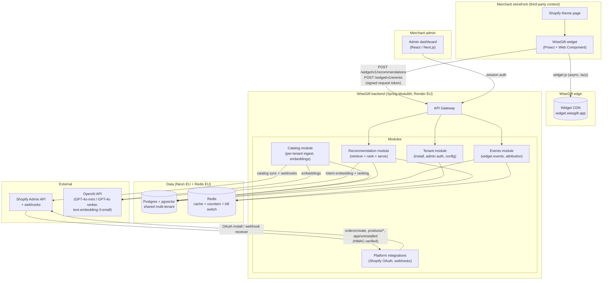

# WiseGift — System Architecture

> B2B rewrite. Supersedes the pre-2026-09-29 B2C architecture (Firebase Auth +
> Firestore + Flutter). Historical context in `docs/decisions.md` (2026-09-29
> entries). Product surface in `docs/product/spec.md`; business & cost
> guardrails in `docs/growth/gtm-b2b.md`.

---

## Environments

| Environment | Widget CDN | Admin dashboard | Backend API | Postgres (Neon) | Redis |
|---|---|---|---|---|---|
| **Production** | `https://widget.wisegift.app` | `https://admin.wisegift.app` | `https://api.wisegift.app` | Neon EU (prod project) | Managed Redis EU (prod) |
| **Staging** | `https://widget-staging.wisegift.app` | `https://admin-staging.wisegift.app` | `https://api-staging.wisegift.app` | Neon EU (staging project) | Managed Redis EU (staging) |
| **Local** | `http://localhost:5173` | `http://localhost:3000` | `http://localhost:8080` | Neon EU (staging branch) or local docker | local docker |

All production and staging infra hosted in **EU regions only** (see `docs/decisions.md` 2026-09-29 "Frozen MVP scope"). Adding US region requires an explicit PO decision + DPA update.

Backend selects environment via `SPRING_PROFILES_ACTIVE=production|staging|local`. Widget bundle is built once per release with hash-based cache-busting (`widget.<hash>.js`). Admin frontend selects the API base via a build-time env var.

---

## 1. Stack

| Layer | Technology | Notes |
|---|---|---|
| Embeddable widget | Preact + Web Components, Shadow DOM | ≤ 50 KB gzipped, async, CDN-served |
| Merchant admin dashboard | Next.js (App Router) | Session auth, same-origin API calls. See `decisions.md` 2026-09-29 "Architecture open questions closed" |
| Backend | Spring Modulith (Java) | Hexagonal per module; evolved from `wisegift-backend` |
| Recommendation LLM (ranker) | OpenAI chat completions via API | `gpt-4o-mini-2024-07-18` default; `gpt-4o-2024-08-06` escalation behind the per-tenant flag `feature_flags.escalate_ranker`. Behind the vendor-neutral `RankingClient` port (`OpenAiRankingClient`). Replaced Claude Haiku 4.5 / Sonnet (`decisions.md` 2026-10-06 "PR 7d"). EU residency: see the row below |
| Embeddings | OpenAI `text-embedding-3-small` (1536d, Matryoshka-reducible) | Stored in pgvector, model version tracked per vector. Same OpenAI account and key as the ranker. See `decisions.md` 2026-09-29 "Architecture open questions closed" |
| OpenAI data residency | OpenAI API project with Europe data residency (decided, not yet switched) | Both `OpenAiEmbeddingClient` and `OpenAiRankingClient` currently call `https://api.openai.com`, which is **US processing**. Decision `decisions.md` 2026-10-14 "LLM processing moves to an OpenAI EU data-residency project": a new EU project and key, with both base URLs (`wisegift.openai.base-url`, `wisegift.ranking.base-url`) pointed at the EU endpoint (`https://eu.api.openai.com`, to be confirmed). Switch is gated on PO preconditions (eligibility, EU availability of the three pinned models, zero data retention, OpenAI DPA/SCCs) and a PO-approved staging env change |
| Primary DB | PostgreSQL + pgvector (Neon EU) | Shared multi-tenant, `tenant_id NOT NULL` |
| Cache + rate limits | Redis (managed, EU) | Response cache, per-tenant usage cap, per-session rate limit, kill switch |
| Platform integrations | Shopify Admin API + Theme App Extensions | MVP; VTEX / SFCC / custom REST post-MVP behind common adapter |
| Widget CDN | Cloudflare or Fastly | Long TTL + hash-based cache-busting |
| Hosting | Render EU (backend + admin) | Widget CDN separate |
| Observability | Structured JSON logs, per-tenant cost telemetry stream | Alerting on daily-spend threshold per tenant |
| Identity — merchant admin | Email + password + Google OAuth (Spring Security + BCrypt) | MVP is single-user per tenant, no SSO, no MFA. See `decisions.md` 2026-09-29 "Architecture open questions closed" |
| Identity — widget shopper | None (anonymous session ID) | No PII. Session ID in localStorage key `wg_session`, written only when measurement is allowed (§7 consent gate) |
| Identity — widget → API | Short-lived HMAC-signed JWT (HS256, 1 h TTL) | Issued by `POST /widget/v1/session`. The tenant is resolved from the request `Origin` host against `platform_credentials.platform_shop_domain` / `custom_domain` (§9.1) |
| Identity — Shopify → API | OAuth (per-tenant tokens) + HMAC on webhooks | Standard Shopify pattern |

---

## 2. High-level architecture



---

## 3. Component responsibilities

### Widget (Preact + Web Components)
Runs inside the merchant's storefront (Shopify theme). One tag on the page: `<wisegift-widget data-tenant-id="…" data-placement="…"></wisegift-widget>`, plus one `<script async>` loading `widget.js` from the CDN. Renders with Shadow DOM isolation; inherits brand accent + typography via CSS variables; ≤ 50 KB gzipped total. Emits events to the WiseGift event API. Each browser session is exposed or holdout according to the server-computed `isHoldout` returned at bootstrap; the widget never rolls its own split. 90/10 by default, or 80/20 for design partners who opt in (`decisions.md` 2026-10-14, M1·2 D4). Measurement is consent-gated (§7).

### Merchant admin dashboard
Standalone web app (React/Next.js). Merchants install the Shopify app, land here for onboarding, widget configuration, placement management, and the analytics dashboard. Single-user per tenant at MVP. Same-origin API access with session auth.

### Backend — Spring Modulith
Single deployable unit (`app/`) — split into services only when scale demands it. Composed of the modules below, each hexagonal (`domain/`, `application/`, `infrastructure/`). Never imports across modules except via published ports. See `decisions.md` 2026-09-30 "Backend Spring Modulith module structure" for design rationale and rejected alternatives.

**Modules (in dependency order):**

| Module | Owns (tables) | Publishes port | Consumes (external) | HTTP surface |
|---|---|---|---|---|
| `shared` | — | — | — | — (value types: `TenantId`, later `SessionId` etc.; HMAC utilities; common exceptions) |
| `tenant` | `tenants`, `admin_users`, `widget_config`, `intent_form_schemas` | `TenantQueryPort` | — | Admin auth (login/register), widget & intent-form config CRUD |
| `platform-integrations` | `platform_credentials`, `catalog_sync_runs` | `PlatformCatalogSource`, `PlatformOrderStream` | Shopify Admin API + webhooks | Shopify OAuth callback, HMAC webhook receivers (`products/*`, `orders/create`, `app/uninstalled`, `inventory_levels/update`) |
| `catalog` | `tenant_products`, `tenant_product_variants`, `precomputed_recs` | `CatalogQueryPort`, `CatalogIngestPort` | OpenAI embeddings API | Admin catalog-sync controls (manual resync, sync-status panel) |
| `recommendation` | `cost_telemetry` | — | OpenAI API (intent embedding + ranker), Redis | `POST /widget/v1/session` (bootstrap), `POST /widget/v1/recommendations` |
| `events` | `sessions`, `events`, `orders_attributed` | `AnalyticsQueryPort` | — | `POST /widget/v1/events`, admin analytics endpoints |
| `app` | — | — | — | Spring Boot entry, Spring Security config, Flyway config, widget JWT-HMAC verification filter |

**Dependency direction:** `shared ← tenant ← {platform-integrations, catalog, events} ← recommendation ← app`. Acyclic; `tenant` is the load-bearing base.

**Cross-cutting placement rules:**
- **Widget → API JWT-HMAC verification:** filter in `app/`; token issuance from `recommendation`'s `/session` bootstrap; tenant lookup via `TenantQueryPort`.
- **Admin session auth:** Spring Security config in `app/`; `AdminAuthenticationService` + `admin_users` in `tenant`.
- **Cost telemetry:** owned by `recommendation` (writer of every sample). Extract if analytics volume grows post-MVP.
- **Kill switch, rate limits, response cache:** Redis-backed, all owned by `recommendation`.
- **HTTP controllers co-located with their domain module** (`infrastructure/in/web`), not centralised in `app/`.

**Explicitly not modules at MVP** (per the same decision entry): no `auth` module, no `admin-api` module, no `widget-api` module, no `telemetry` module, no `analytics` module. Adding one requires a decision entry justifying it against this list.

### Data
- **Postgres + pgvector (Neon EU)** — shared multi-tenant, every table with tenant data has `tenant_id UUID NOT NULL` with a composite index leading with `tenant_id`. Embeddings live in pgvector columns.
- **Redis (managed EU)** — response cache (24h TTL), per-tenant usage-cap counters, per-session rate-limit counters, per-tenant kill-switch flag. Ephemeral; no durable data.

### External services
- **Shopify Admin API** — catalog reads, order webhooks, theme extension metadata. Rate limit: 2 req/s leaky-bucket baseline, 40 burst (per tenant).
- **OpenAI API**: three uses.
  - `gpt-4o-mini-2024-07-18` for re-ranking and intent parsing (default).
  - `gpt-4o-2024-08-06` for full-form gift-intent flows, behind the per-tenant flag `feature_flags.escalate_ranker`.
  - `text-embedding-3-small` for catalog embeddings at ingest and for the shopper intent at serve time.

  The ranker receives the shopper intent payload, including free-text interests, plus up to 50 candidate products. Every call is tagged with `tenant_id` for cost attribution. **Region:** calls currently go to `api.openai.com` (US processing). Moving them to an OpenAI EU data-residency project is decided but not yet switched (§1, `decisions.md` 2026-10-14).

---

## 4. Multi-tenancy model

Shared database, strict row-level tenant scoping.

- **Every tenant-scoped table** has `tenant_id UUID NOT NULL` with a composite index `(tenant_id, ...)` leading with tenant.
- **Every request** (except OAuth install and public webhook receivers) is scoped via a request-scoped `TenantContext` bean, populated by:
  - Admin API: session → user → tenant lookup.
  - Widget API: signed request token → `tenant_id` claim + domain allowlist check.
  - Webhook receivers: shop domain → tenant lookup.
- **Every repository method** takes `tenant_id` explicitly or reads it from `TenantContext`. Lint / architecture test flags any raw SQL missing `WHERE tenant_id = ?`.
- **Cross-tenant queries never exist** at the application layer. Cross-tenant analytics jobs (if ever needed) run as scheduled batch jobs with an explicit "cross-tenant" annotation and no request context.
- **Integration tests** seed at least two tenants and assert zero cross-leakage on every read path. Non-negotiable in CI.

### Tenant lifecycle

| Event | Trigger | Effect |
|---|---|---|
| Create | Shopify OAuth install completes | `tenants` row created; `active = false` until wizard completes |
| Activate | Onboarding wizard "Go live" | `active = true`; widget starts rendering; events start recording |
| Soft-delete | Shopify `app/uninstalled` webhook | `active = false`, `soft_deleted_at = now()`; widget serves nothing; catalog sync stops |
| Reactivate | Reinstall within 30 days | `active = true`, `soft_deleted_at = null`; existing tenant record reused |
| Hard purge | Scheduled daily job at 03:00 UTC | Tenants with `soft_deleted_at < now() - 30 days` → all `tenant_id`-scoped rows deleted across every module's tables |

---

## 5. Recommendation pipeline

### Serving policy (live vs. precomputed)

Every recommendation request goes through this decision tree:

1. **Cache lookup** — Redis key `rec:{tenant_id}:{intent_signature}:{context_signature}`, 24h TTL. Hit → return cached response, `served_from = cache`.
2. **Guardrail checks** —
   - Per-tenant usage cap reached this month? → fall through to precomputed.
   - Per-session rate limit reached this hour? → fall through to precomputed.
   - Per-tenant kill switch tripped? → fall through to precomputed.
3. **Intent signal check** — no real intent (shopper has not submitted the intent form, PDP-context view only)? → serve precomputed cold recs for the current SKU.
4. **Live LLM path** —
   - Embed the intent (interests + budget + occasion + context) via the embedding model.
   - Vector search on `tenant_products.embedding` for top-K candidates (K = 50).
   - Re-rank the top-K + intent payload via OpenAI GPT-4o-mini (GPT-4o if the tenant's `escalate_ranker` flag is on).
   - Return top-N (default 5) with `served_from = live_llm`.
5. **Fallback** — LLM error or vector search returns zero → precomputed cold recs; if those are also empty, top-N merchant bestsellers; last resort, hide the recommendation slot. The widget never renders an error state.

### Cost + attribution tagging

Every response tags: `tenant_id`, `placement`, `model`, `input_tokens`, `output_tokens`, `cache_hit`, `served_from`, `latency_ms`. Emitted on every call (not sampled) to the cost telemetry stream. Every response body includes `served_from` for downstream event tagging.

### Precomputed cold recs

- Nightly job per tenant (`03:00 UTC`, offset by tenant hash to smear load).
- For each active SKU, compute top-N recommendations using vector nearest-neighbour + heuristic ranking (price band, category diversity). No LLM calls.
- Stored in `precomputed_recs (tenant_id, source_platform_product_id, rank, recommended_platform_product_id, computed_at)`.
- Served instantly when the live path is over-cap, over-limit, kill-switched, or missing intent signal.
- Re-run on catalog changes exceeding a per-tenant threshold (e.g. >5% of SKUs updated in a day).

### Embeddings

- Computed at ingest, on catalog update, and never at recommendation-serve time.
- Recompute only when title or description changes (skip on price / inventory-only updates).
- Batched per tenant, tagged with `tenant_id` for cost attribution.
- Model version stored on each vector row; model upgrade requires a per-tenant re-embed job, not silent drift.

---

## 6. Cost guardrails infrastructure

Cost guardrails from `docs/growth/gtm-b2b.md` are engineering requirements, not v2. All enforced at the Recommendation module's API layer.

| Guardrail | Backing store | Trigger |
|---|---|---|
| Per-tenant usage cap | Redis counter `cap:{tenant_id}:{YYYY-MM}` | Configurable per tenant; default 50k live-LLM calls / month during pilot |
| Response cache | Redis, 24h TTL | Hit rate target > 60% at steady state |
| Session rate limit | Redis counter `rate:{session_id}:{YYYY-MM-DD-HH}` | Max 20 live-LLM calls / session / hour |
| Kill switch | Redis flag `kill:{tenant_id}` (bool + reason) | Daily-spend threshold from cost telemetry; ops-alert; auto-set true |
| Cost telemetry | Postgres `cost_telemetry` table at MVP; promote to Grafana Cloud EU post-MVP | Every rec call, unsampled. See `decisions.md` 2026-09-29 "Architecture open questions closed" |

Kill switch behaviour: while set, every recommendation call serves from precomputed cold recs. Widget shopper cannot tell. Ops dashboard shows the tenant in "degraded" state until manually reset.

---

## 7. Attribution & event pipeline

### Session lifecycle

- **Consent gate (pilot gate, `decisions.md` 2026-10-14 "`_wg_session` order join … G5").** When the tenant's `consentModeRequired` flag is set (`tenants.consent_mode_required`, default `true`, fail closed), the widget checks the Shopify Customer Privacy API (`analyticsProcessingAllowed()`) first. Without consent: no session ID, no localStorage, no cart attribute, no events. Recs are served in degraded mode (per-request holdout coin flip, `attribution_mode=degraded`), and these shoppers are outside the measured population. Widget and backend ship as separate PRs. Both must land before any pilot storefront.
  - **Ordering.** The widget learns `consentModeRequired` only from the `POST /widget/v1/session` response (§9.2). It therefore must not persist the `sessionId` returned by that call, write the cart attribute, or emit events until it has both the flag and, when the flag is `true`, a positive `analyticsProcessingAllowed()`. In the no-consent case the returned `sessionId` lives in memory only, for the lifetime of the page, to bind the token for `/widget/v1/recommendations`. Because a fresh UUID is minted on every bootstrap, that session's `isHoldout` is effectively a per-page-load coin flip (degraded mode).
  - **Open (frontend-engineer + security-and-privacy):** whether the widget may read and send an already-stored `wg_session` on the bootstrap request before it knows the flag. Reading storage is itself access under ePrivacy Art. 5(3). The conservative rule is: check `analyticsProcessingAllowed()` locally first, and send no stored ID without a positive signal. Under that rule, a `consentModeRequired = false` tenant would need a second bootstrap to keep its sticky session, so this tradeoff needs a decision.
  - **`consentModeRequired = false` (PENDING PO + attorney confirmation).** This is the legitimate-interest mode: the widget measures without a consent signal, as in the 2026-09-29 position (first-party UUID, no PII, 30-day TTL, EU-only, GDPR Art. 6(1)(f)). It does not call `analyticsProcessingAllowed()` before measuring. The 2026-10-14 security review found that the `_wg_session` cart attribute creates a join key to the merchant's identified customer, which weakens the 2026-09-29 reasoning. So no tenant should be set to `false` until the PO and an attorney confirm this mode is still defensible (`docs/legal/consent-position.md`).
- On first widget render on a browser (consent permitting): generate UUID v4 → localStorage key `wg_session`, 30-day sliding TTL.
- Assign exposed vs holdout deterministically from the session ID: `hash(session_id) mod 100 < holdout_percent → holdout`, else exposed. `holdout_percent` is per tenant: 10 by default, 20 for design partners who opt in (`decisions.md` 2026-10-14, M1·2 D4). Assignment stored on first `widget_shown` event; never re-rolled. A split change applies only to sessions first shown after it, and every change records its effective-from timestamp, so lift analysis can segment by split period. `sessions.is_holdout` is authoritative for measurement. The client `is_holdout` flag on events is never trusted.
- Holdout sessions render the **placebo**: a neutral collapsed rec slot with no "no matches" copy, and no `/widget/v1/recommendations` call (`decisions.md` 2026-10-14, M1·2 D6).
- Every widget event carries `session_id`, `is_holdout`, `tenant_id`, `placement`.

### Event ingest

- Widget batches events (up to 10 / request, 1-second flush interval) and POSTs to `POST /widget/v1/events`.
- Server validates against a strict schema (unknown fields rejected).
- Events enqueued to an in-process async processor; written to `events` table.
- p95 write latency < 100 ms; fire-and-forget from widget's perspective.

### Order attribution

- Shopify `orders/create` webhook → HMAC-verified → filtered at ingest (drop customer PII fields) → stored in `orders_attributed`.
- Session correlation: the widget writes the session id to the **`_wg_session` cart attribute** for **both arms**, so it reaches the order's `note_attributes`. The cart POST stays on the storefront origin. There is no write when localStorage is blocked (widget PR #17, R1–R4). The widget also appends `?wg_session=<id>` to rec-card links (exposed only). The webhook reads, in order: `_wg_session` → legacy `wg_session` cart attribute → URL marker (`landing_site` / `referring_site`). It accepts strict v4 UUIDs only (`decisions.md` 2026-10-14). Because URL-marker orders are exposed-only, M1·2 §3.1 / G2 excludes them from lift.
- Attribution window: **7 days** anchored on the session's **last symmetric widget event** before the order (`widget_shown` / `widget_engaged` / `intent_submitted`). The order must come after the session's first trigger event. It is **not** anchored on `product_clicked`, which holdout cannot produce (`decisions.md` 2026-10-14, M1·2 D3; full rule in `m1-2-lift-measurement.md` §3.2).
- Unattributed orders still stored (contribute to merchant-wide baselines) but do not count toward per-session lift.

### Lift computation

Normative detail: `docs/engineering/m1-2-lift-measurement.md` (populations §1, KPIs §2, statistics §5, computation model §6, API §7). Decisions: `decisions.md` 2026-10-14 (M1·2 D1–D9).
- Unit = widget session. **Headline population = `triggered`** (≥ 1 `intent_submitted`). **`shown`** is returned as the secondary, store-level view (D2).
- Lift KPIs (`exposed vs holdout`, p-value + CI): conversion rate, AOV, revenue-per-session. Revenue = Shopify `total_price`: gross, including shipping and tax, before refunds, and labelled as such (D8). Widget CTR: M1·2 §2.1 treats it as an A/A integrity check, not a lift KPI. This is not yet a recorded PO decision; `spec.md` still lists it as a lift tile.
- The add-to-cart KPI is dropped at MVP, and `carts/update` is not ingested. It is replaced by exposed-only **rec click-through** and **rec purchase rate**, with no lift claim (D1).
- Significance renders green / red (significant negative) / grey / grey (D7). Day boundaries are **UTC** (D9).
- Results cached hourly. A minimum-data callout shows if fewer than 5,000 exposed sessions are in the headline population for the selected range. The response also carries "readout at N sessions" and the MDE at current n (D4). Case-study claims come only from the pre-registered readout (D4).

---

## 8. Database schema

> **Factual correction (2026-10-19, backend-engineer).** This section was reconciled against the real backend schema (Flyway `V1`–`V15`) and the JPA entities on `develop`, as input to the record-of-processing review. Changes: added the columns `tenants.currency`/`vertical_pack`/`store_type_set_at`/`live_since`, `events.pre_intent_recs`, `orders_attributed.is_test`, `tenant_products.embedding_source_hash`/`excluded_reason`, and the `widget_config` hook/trigger/intent-form columns; corrected `orders_attributed.attribution_source` from "PROPOSED, not built" to built (V7); added the `widget_config_events` and `budget_tier_sets` tables. **Known remaining discrepancy:** the `tenants.holdout_percent` column and a `tenant_holdout_changes` table are described below but are **not** in the real schema (no entity field, no migration; `ddl-auto=validate` would reject them) — left in place pending a PO decision on whether they are planned or should be struck.

Every table below has `tenant_id UUID NOT NULL` except `tenants` itself and the platform-integration OAuth store (which uses `tenant_id` as its own PK link).

### `tenants`

Platform-agnostic. The identifiers a merchant carries on their source platform (Shopify shop domain + shop ID, VTEX account, SFCC realm) live on `platform_credentials`, not here. See `decisions.md` 2026-09-29 "tenants ↔ platform_credentials split".

| Column | Type | Notes |
|---|---|---|
| tenant_id | UUID | PK |
| region | VARCHAR(2) | ISO region (`EU`); reserved for future US expansion |
| vertical | VARCHAR(32) | e.g. `fashion`, `beauty`, `home`, `tech`, `books`, `food`, `kids`, `jewelry`, `other` |
| plan | VARCHAR(32) | `PILOT`, `STARTER`, `GROWTH`, `SCALE`, `ENTERPRISE` (Java enum names, `@Enumerated(EnumType.STRING)`) |
| monthly_usage_cap | INTEGER | Live-LLM recommendation calls / month; default 50000 |
| daily_spend_cap | NUMERIC(10,2) | Nullable. NULL = fall through to per-plan constant. Set explicitly only for pilots with custom headroom or outlier tenants. See `decisions.md` 2026-09-29 "Resolved 6 open questions" |
| feature_flags | JSONB | Per-tenant boolean flags (e.g. `{"escalate_ranker": true}`, which routes full-form gift intents to GPT-4o). Starts as `{}`. See `decisions.md` 2026-09-29 and 2026-10-06 "PR 7d" |
| consent_mode_required | BOOLEAN | Default **`true`** (fail closed), exposed to the widget as `consentModeRequired`. When `true`, the widget measures only if the Shopify Customer Privacy API reports `analyticsProcessingAllowed()`. Without consent: no localStorage write, no session ID, no cart attribute, no event emission, and holdout falls back to a per-request coin flip with `attribution_mode=degraded`. `false` = legitimate-interest mode, measuring without a consent signal: **PENDING PO + attorney confirmation** (§7). Delivered to the widget as a top-level boolean in the session bootstrap response (§9.2) and to the admin in `GET /admin/v1/auth/me` → `tenant.consentModeRequired`. See `decisions.md` 2026-10-14 "`_wg_session` order join … G5", which supersedes the 2026-09-29 "Widget consent for EU" default of `false` |
| holdout_percent | SMALLINT | Allowed values 10 or 20, default 10. 20 = design-partner 80/20 opt-in. Passed to `HoldoutAssigner` by the session bootstrap and the `widget_shown` sticky assignment. Each change is audited with an effective-from timestamp (e.g. `tenant_holdout_changes`). See `decisions.md` 2026-10-14 "M1·2 D4" |
| active | BOOLEAN | `false` until onboarding wizard completes. The widget only runs for a **live** tenant (`active = true` and `soft_deleted_at IS NULL`): otherwise every `/widget/v1/*` call is refused with 403 (decisions.md 2026-10-16 Q-C8; backend PR #85). Going live requires a confirmed contact email (`409 contact_email_required`, M2·3) |
| contact_email | VARCHAR(254) | Nullable. Merchant's notice address (DPA notices, billing, essential service notices; never marketing). Stored trimmed, as entered; never logged. Set only together with `contact_email_confirmed_at` (CHECK: both null or both set). See decisions.md 2026-10-16 "Merchant contact email…" (BE-3, V10) |
| contact_email_confirmed_at | TIMESTAMPTZ | Nullable. Set to now() on every in-app confirmation (first set, change, re-confirm). Non-null = confirmed; gates go-live |
| vertical_pack | VARCHAR(16) | NOT NULL DEFAULT `general`; CHECK `fashion` \| `home_decor` \| `general`. Niche-pack choice from onboarding Step 1 ("What do you sell?"), written together with `vertical` (M2·3, V11) |
| store_type_set_at | TIMESTAMPTZ | Nullable. Set on every Step-1 answer. NULL = merchant has never answered; distinguishes "never chosen" from the `general` default (V11) |
| live_since | TIMESTAMPTZ | Nullable. Stamped by the go-live command; kept on pause/reinstall, overwritten on the next go-live. Existing live tenants were backfilled from `updated_at` (V11) |
| currency | VARCHAR(3) | Nullable; CHECK `^[A-Z]{3}$`. Shop's ISO 4217 currency read from Shopify `shop.json` at install and refreshed on `shop/update` (F2, V14). NULL = unknown; widget then shows budget tier names only (OQ-3) |
| soft_deleted_at | TIMESTAMPTZ | Nullable |
| created_at | TIMESTAMPTZ | |
| updated_at | TIMESTAMPTZ | |

### `platform_credentials`

Holds both the OAuth material and the platform-side identity of the merchant. One row per tenant at MVP (single platform per tenant); PK becomes `(tenant_id, platform)` if a tenant ever runs on multiple platforms.

| Column | Type | Notes |
|---|---|---|
| tenant_id | UUID | PK + FK to `tenants` |
| platform | VARCHAR(16) | `shopify` (MVP), later `vtex`, `sfcc` |
| platform_shop_domain | VARCHAR(255) | Merchant's identifier on the source platform. Shopify: `merchant.myshopify.com`. VTEX: account name. SFCC: realm host. Unique per `(platform, platform_shop_domain)` |
| platform_shop_id | VARCHAR(64) | Platform-native numeric or opaque ID as string (Shopify shop_id, VTEX account_id, SFCC organization_id). Stringly-typed so post-MVP platforms with non-numeric IDs land cleanly |
| custom_domain | VARCHAR(255) | Nullable. Merchant's storefront domain if configured (e.g. `shop.example.com`). Populated from Shopify Admin API `GET /shop.json → domain` at install (REST has no `primary_domain`; fixed in BE-2, decisions.md 2026-10-15 finding F-A); refreshed on `shop/update` webhook or nightly reconciliation. Widget request-origin allowlist = `[platform_shop_domain, custom_domain].filter(non-null)`. See `decisions.md` 2026-09-29 "Architecture open questions closed" |
| oauth_access_token_encrypted | TEXT | Encrypted at rest; decrypted only in memory for the outbound call |
| scopes | TEXT[] | Granted OAuth scopes |
| installed_at | TIMESTAMPTZ | |
| refreshed_at | TIMESTAMPTZ | |
| credential_invalid_at | TIMESTAMPTZ | Nullable. Set when Shopify answers 401 to the stored token; a flagged credential is not live, so the next admin open gets `409 installation_required` and Token Exchange re-runs and clears it (BE-2b, V9) |

### `tenant_contact_email_events`

Audit trail of contact-email confirmations (BE-3, V10). Stores **no address and no staff identity** (decisions.md 2026-10-15 decision 4). Included in the M3·1 hard purge.

| Column | Type | Notes |
|---|---|---|
| id | BIGSERIAL | PK |
| tenant_id | UUID | NOT NULL, FK to `tenants` |
| action | VARCHAR(16) | CHECK `set`, `changed`, `reconfirmed` |
| occurred_at | TIMESTAMPTZ | NOT NULL; index `(tenant_id, occurred_at)` |

### `admin_users`

Merchant admin identity. MVP is one row per tenant. **Factual note (2026-10-19):** the live embedded-admin path authenticates with Shopify App Bridge session tokens (`ShopifyIdTokenVerifier` → `PlatformAdminAuthenticator`); that path reads only the shop host from the token (the `sub`/`sid`/`jti` staff claims are never read, stored, or logged) and never touches this table. `admin_users` is written only by the legacy email/password + Google path (`AdminAuthenticationService`, `AdminAuthController`), which the embedded model supersedes; the table still exists and may hold legacy rows.

| Column | Type | Notes |
|---|---|---|
| id | UUID | PK |
| tenant_id | UUID | FK, indexed |
| email | VARCHAR(255) | Unique |
| password_hash | TEXT | Nullable if Google OAuth only |
| google_sub | VARCHAR(255) | Nullable, unique when set |
| created_at | TIMESTAMPTZ | |

### `tenant_products`

Per-tenant catalog snapshot. One row per Shopify product per tenant.

| Column | Type | Notes |
|---|---|---|
| id | BIGINT | PK, auto-increment |
| tenant_id | UUID | Indexed with `(tenant_id, platform_product_id)` unique |
| platform_product_id | VARCHAR(64) | Source-of-truth product ID from the merchant's platform. Shopify: numeric shop_id stringified. VTEX: product ID. SFCC: master product ID. Stringly typed for cross-platform consistency (see `decisions.md` 2026-09-29) |
| slug | VARCHAR(255) | URL slug on the merchant's storefront. Shopify: `handle`. VTEX: `slug`. SFCC: URL keyword |
| title | VARCHAR(500) | |
| description | TEXT | |
| price_min | DECIMAL(12,2) | Min across variants |
| price_max | DECIMAL(12,2) | Max across variants |
| currency | VARCHAR(3) | ISO 4217 |
| image_url | VARCHAR(2000) | |
| product_type | VARCHAR(255) | Shopify product type field |
| tags | TEXT[] | Shopify tags |
| available | BOOLEAN | True if any variant in stock |
| content_hash | VARCHAR(64) | SHA-256 of title+description+type+tags; drives embed recompute decision |
| excluded_reason | VARCHAR(16) | Nullable; CHECK `GIFT_CARD` \| `UNPUBLISHED`. NULL = recommendable. Set from full product payloads only (full sync, products/create, products/update); the price refresh and inventory webhook never touch it (OQ-9, V13) |
| embedding | vector(1536) | pgvector; nullable while awaiting first embed pass. 1536d matches OpenAI `text-embedding-3-small` |
| embedding_source_hash | VARCHAR(64) | Nullable. The `content_hash` the current embedding was computed from; comparing it against the live `content_hash` tells the embed pass whether the vector is stale without a provider round trip (V2) |
| embedding_model_version | VARCHAR(32) | e.g. `text-embedding-3-small`; nullable if embedding is null |
| last_seen_at | TIMESTAMPTZ | Updated on catalog sync + webhook |
| last_embedded_at | TIMESTAMPTZ | Nullable |

### `tenant_product_variants`

| Column | Type | Notes |
|---|---|---|
| id | BIGINT | PK |
| tenant_id | UUID | |
| tenant_product_id | BIGINT | FK |
| platform_variant_id | VARCHAR(64) | Source-of-truth variant ID from the merchant's platform |
| price | DECIMAL(12,2) | |
| available | BOOLEAN | |

### `catalog_sync_runs`

One row per reconciliation run. Drives the deactivation-on-successful-miss policy (`data.md` §3) and the webhook-health indicator in the admin sync-status panel (`spec.md` → Merchant admin → Catalog sync controls). See `decisions.md` 2026-09-29.

| Column | Type | Notes |
|---|---|---|
| id | BIGINT | PK, auto-increment |
| tenant_id | UUID | Indexed with `(tenant_id, started_at DESC)` for last-run lookup |
| started_at | TIMESTAMPTZ | |
| finished_at | TIMESTAMPTZ | Nullable while the run is in flight |
| status | VARCHAR(16) | `ok`, `failed`, `partial` |
| products_seen_count | INTEGER | Nullable if the run failed before counting completed |
| pages_fetched | INTEGER | Shopify pagination pages consumed |
| trigger | VARCHAR(16) | `nightly`, `manual_full`, `manual_prices` — matches the three ingestion entry points in `data.md` §3 |

A run counts as "successful" for deactivation-counter purposes only if `status='ok'` AND `products_seen_count` is within ±10% of the last successful run's count.

### `intent_form_schemas`

Versioned per tenant so verticalised packs can be introduced without breaking live widgets.

| Column | Type | Notes |
|---|---|---|
| tenant_id | UUID | |
| version | INTEGER | Monotonic per tenant |
| schema_json | JSONB | Field definitions, labels, options |
| active | BOOLEAN | Exactly one active version per tenant |
| created_at | TIMESTAMPTZ | |

Composite PK `(tenant_id, version)`.

### `widget_config`

| Column | Type | Notes |
|---|---|---|
| tenant_id | UUID | PK |
| hook_copy | TEXT | Localised strings by lang |
| brand_accent_color | VARCHAR(7) | Hex. Superseded by `theme_tokens.accent_color`; kept for backward-shape reasons and read as a second-level fallback. Asymmetry is intentional for MVP — consolidation deferred to a v2 shape pass |
| border_radius_px | INTEGER | Reused by the theming pathway as the source of `--wg-border-radius`; not duplicated inside `theme_tokens` |
| recs_per_widget | INTEGER | 3–10 |
| placements_enabled | TEXT[] | e.g. `["home_hero", "pdp_slot", "gift_finder"]` |
| placement_hooks | JSONB | NOT NULL DEFAULT `{}`. Per-placement hook copy overrides, now nested `placement → language → field → string` (e.g. `{"pdp_slot": {"en": {"headline": "..."}}}`). Only populated entries override the code-level default (V3, reshaped V12). No shopper data |
| intent_form_fields | JSONB | NOT NULL, default `{"relationship":"required","occasion":"required","budget":"required","interests":"optional"}`. Independent `required` \| `optional` \| `hidden` visibility per intent field (V5). This is merchant *configuration* of which questions the widget asks — not any shopper answer |
| trigger_mode | VARCHAR(16) | NOT NULL DEFAULT `side_tab`; CHECK `side_tab` \| `pill`. Floating-trigger style, moved from the theme block to admin (V12) |
| trigger_position | VARCHAR(16) | NOT NULL DEFAULT `bottom_right`; CHECK `bottom_right` \| `bottom_left` (V12) |
| trigger_background_color | VARCHAR(7) | Nullable hex; NULL = inherit accent background (V12) |
| trigger_text_color | VARCHAR(7) | Nullable hex; NULL = contrast-picked text (V12) |
| theme_tokens | JSONB | Merchant-set design-token overrides. Nullable, defaults `{}`; only explicitly-set overrides live here (unset tokens fall through to the Shopify theme variable, then the WiseGift default — see §10.5). Shape below |
| updated_at | TIMESTAMPTZ | |

`theme_tokens` JSONB shape (every key nullable / omissible; unknown keys rejected at the admin API boundary):

| Key | Type | Notes |
|---|---|---|
| accent_color | VARCHAR(7) | Hex. Emitted as `--wg-accent-color`. Falls back to `var(--color-accent)` then WiseGift default |
| text_color | VARCHAR(7) | Hex. Emitted as `--wg-text-color`. Falls back to `var(--color-foreground)` then default |
| background_color | VARCHAR(7) | Hex. Emitted as `--wg-background-color`. Falls back to `var(--color-background)` then default |
| font_family | TEXT | CSS font-family value. Emitted as `--wg-font-family`. Falls back to `var(--font-body-family)` then system stack |
| heading_font_family | TEXT | CSS font-family value. Emitted as `--wg-heading-font-family`. Falls back to `var(--font-heading-family)` then to `--wg-font-family` |
| spacing_scale | VARCHAR(8) | Enum: `compact` \| `cozy` \| `roomy`. Resolved to a preset scale inline by the widget (see §10.5). No Shopify equivalent |
| card_shadow | VARCHAR(8) | Enum: `none` \| `subtle` \| `medium`. Resolved to a preset shadow definition inline by the widget (see §10.5). No Shopify equivalent |

Note: `border_radius_px` lives on the `widget_config` row itself (existing column), not inside `theme_tokens`. The widget resolves it to `--wg-border-radius` at mount alongside the JSONB overrides.

### `widget_config_events`

Change-date log for lift readouts (V12): a copy, trigger or pack change moves the treatment for both arms at once. **Stores when and where a change happened, never the copy text itself** — no shopper data, no merchant free text. Purged with the tenant.

| Column | Type | Notes |
|---|---|---|
| id | BIGSERIAL | PK |
| tenant_id | UUID | NOT NULL, FK to `tenants`; index `(tenant_id, occurred_at)` |
| kind | VARCHAR(16) | CHECK `copy` \| `copy_reset` \| `trigger` \| `pack` |
| placement | VARCHAR(32) | Nullable |
| language | VARCHAR(2) | Nullable |
| occurred_at | TIMESTAMPTZ | NOT NULL |

### `budget_tier_sets`

Computed budget tier edges per tenant (V15, budget-tiers.md §1.8). One row per tier-set version; a new row is written only when the §1.6 hysteresis rule adopts a change. Inactive rows are retained so an event's tier-set version maps back to the exact edges shown. Derived from the merchant catalog's price distribution — no shopper data.

| Column | Type | Notes |
|---|---|---|
| tenant_id | UUID | NOT NULL, FK to `tenants`; composite PK `(tenant_id, version)` |
| version | INTEGER | NOT NULL |
| source | VARCHAR(16) | CHECK `catalogue` \| `pack_default` \| `custom` \| `none` |
| edges | INTEGER[] | NOT NULL. Tier boundary values |
| currency | VARCHAR(3) | Nullable; CHECK `^[A-Z]{3}$` |
| product_count | INTEGER | NOT NULL. Products the set was computed over |
| tier_counts | INTEGER[] | NOT NULL. Product count per tier |
| algorithm_version | VARCHAR(16) | NOT NULL |
| active | BOOLEAN | NOT NULL. Exactly one active row per tenant (partial unique index `uq_budget_tier_sets_active`) |
| computed_at | TIMESTAMPTZ | NOT NULL |

### `precomputed_recs`

| Column | Type | Notes |
|---|---|---|
| tenant_id | UUID | Indexed with `(tenant_id, source_platform_product_id)` |
| source_platform_product_id | VARCHAR(64) | |
| rank | INTEGER | 1..N |
| recommended_platform_product_id | VARCHAR(64) | |
| computed_at | TIMESTAMPTZ | |

### `sessions`

| Column | Type | Notes |
|---|---|---|
| session_id | UUID | PK |
| tenant_id | UUID | Indexed |
| is_holdout | BOOLEAN | Deterministic on first render, never re-rolled |
| first_seen_at | TIMESTAMPTZ | |
| last_seen_at | TIMESTAMPTZ | |

### `events`

Widget event stream (append-only).

| Column | Type | Notes |
|---|---|---|
| id | BIGINT | PK, auto-increment |
| tenant_id | UUID | Indexed with `(tenant_id, occurred_at)` |
| session_id | UUID | |
| event_type | VARCHAR(32) | `widget_shown`, `widget_engaged`, `intent_submitted`, `product_clicked` |
| placement | VARCHAR(32) | |
| intent_mode | VARCHAR(8) | `self`, `gift`, or null |
| is_holdout | BOOLEAN | Denormalised from `sessions` for query speed |
| platform_product_id | VARCHAR(64) | Nullable |
| rank_score | DECIMAL(6,4) | Nullable |
| served_from | VARCHAR(16) | Nullable |
| intent_form_schema_version | INTEGER | Nullable. Set only when `event_type='intent_submitted'`; identifies which `intent_form_schemas.version` the payload conforms to, so the v2 learning loop can read historical events across schema upgrades without a backfill. See `decisions.md` 2026-09-29 |
| pre_intent_recs | BOOLEAN | NOT NULL DEFAULT `false` (V7). True only on a `widget_shown` whose mount renders recs before any intent, making that `widget_shown` the session's trigger (M1·2 P1 / G13). Normalised to false on any other event type |
| occurred_at | TIMESTAMPTZ | |

**No shopper-answer columns.** The `events` table stores no `relationship`, `occasion`, `budget`, or free-text `interests` — only the enumerated `event_type`/`placement`/`intent_mode` plus the product/rank/served-from telemetry above. The shopper's intent-form answers are never persisted here or anywhere else (see §5 / §12).

### `orders_attributed`

Order webhook, filtered at ingest (no customer PII). Orders are stored regardless of whether the shopper ever saw the widget (unattributed orders have a NULL `session_id` and feed merchant-wide baselines). Orders for a **non-live tenant** (`active = false`, soft-deleted, or missing) are dropped before any dedup read, persist, or body-field logging — no shopper-data processing before go-live (`OrderAttributionIngestService`, decisions.md 2026-10-16 Q-C8; the controller still answers 200).

| Column | Type | Notes |
|---|---|---|
| platform_order_id | VARCHAR(64) | PK |
| tenant_id | UUID | |
| session_id | UUID | Nullable if not correlated. Pseudonymous personal data. **Nulled at 120 days** (retention, below) |
| attribution_source | VARCHAR(16) | Built (V7); CHECK `note_attribute` \| `landing_site` \| `referring_site`. Nullable. Which marker produced `session_id`: `note_attribute` (the `_wg_session` or legacy `wg_session` cart attribute, written for both arms), `landing_site` or `referring_site` (URL marker, exposed-only). Lift uses `note_attribute` only; rows ingested before V7 have a NULL source and the analytics response flags `attributionSourceMixed: true` |
| is_test | BOOLEAN | NOT NULL DEFAULT `false` (V7). Set from the Shopify order `test` flag. Test checkouts are kept but excluded from every lift readout (G6 / spec §3.1.5) |
| total_price | DECIMAL(12,2) | Shopify `total_price`: gross, incl. shipping and tax, before refunds (M1·2 D8) |
| currency | VARCHAR(3) | |
| line_items | JSONB | `[{platform_product_id, quantity, price}, ...]`; only these three fields are mapped from the webhook. The PII drop happens in `ShopifyWebhookController.mapWebhookNodeToOrderData` **before** persist/publish/log: `customer`, `email`, `phone`, `billing_address`, `shipping_address`, and `client_details` are never read, so they have no path into the system |
| created_at | TIMESTAMPTZ | Shopify order `created_at`. The attribution-window clock (`m1-2-lift-measurement.md` §3.2) and the 18-month retention clock. Falls back to `received_at` when null |
| received_at | TIMESTAMPTZ | Webhook receipt time |

### `cost_telemetry` (optional durable store)

If cost telemetry is streamed to Prometheus / OpenTelemetry, this table may not exist. If durable persistence is chosen for audit:

| Column | Type | Notes |
|---|---|---|
| id | BIGINT | PK |
| tenant_id | UUID | Indexed with `(tenant_id, occurred_at)` |
| placement | VARCHAR(32) | |
| model | VARCHAR(32) | |
| input_tokens | INTEGER | |
| output_tokens | INTEGER | |
| cache_hit | BOOLEAN | |
| served_from | VARCHAR(16) | |
| latency_ms | INTEGER | |
| occurred_at | TIMESTAMPTZ | |

### `analytics_kpi_daily` (proposed, M3·1)

An anonymous daily aggregate: one row per `(tenant_id, day, placement, arm, population, metric_key)`. It holds sufficient statistics only, with no session IDs. Shape: `m1-2-lift-measurement.md` §6.1. It is not built yet.

### Data retention (`decisions.md` 2026-10-14, M1·2 D5 + "Order data … 18-month retention")

| Data | Retention | Notes |
|---|---|---|
| `events` (raw) | **120 days** from `occurred_at` | Pseudonymous (`session_id`) |
| `sessions` | **120 days** after `last_seen_at` | Must outlive the last event that references it |
| `orders_attributed.session_id` | **Nulled at 120 days** | Breaks the customer ↔ widget-history link that the `_wg_session` cart attribute creates. The order row itself stays |
| `orders_attributed` rows (attributed and unattributed) | **18 months** from order `created_at`, then hard-deleted | PII-free. Kept for merchant-wide baselines and year-over-year comparison |
| `analytics_kpi_daily` | **18 months** | Anonymous aggregate; serves trend lines beyond raw retention |

**Enforcement: the M3·1 scheduled purge job, which is not built yet.** Until it ships, nothing is purged and every row above is kept indefinitely. Tenant hard-purge after uninstall (§4, also M3·1 and also not built) is separate and overrides these periods: everything for that tenant goes at day 30.

---

## 9. API contracts

### 9.1 Authentication summary

| Caller | Mechanism | Path prefix |
|---|---|---|
| Widget (shopper's browser) | Short-lived HMAC-signed JWT (HS256, 1 h TTL, issued by `POST /widget/v1/session`) | `/widget/v1/*` |
| Merchant admin (dashboard session) | Session cookie (HTTPOnly, SameSite=Lax) after email+password or Google login, reached through the admin's same-origin Next.js proxy (`decisions.md` 2026-10-14 "Admin ↔ backend transport"). The embedded-admin auth model (App Bridge session tokens) is PENDING | `/admin/v1/*` |
| Shopify webhook | HMAC verified against per-app shared secret | `/webhooks/shopify/*` |
| Internal (jobs, ops) | mTLS or a rotating internal token | `/internal/*` |

Widget token issuance flow (as built, `WidgetSessionController`):
1. The widget calls `POST /widget/v1/session` with `{ sessionId?, placement }`. The 2026-10-07 decision moved this call to the shopper's first interaction with the hook, not widget mount.
2. The server resolves the tenant from the browser `Origin` header: the host is matched against `platform_credentials.platform_shop_domain`, then `custom_domain`. A missing or unknown Origin returns **403**. A tenant that is not live (`active = false`, soft-deleted or missing) also gets **403 with no body**, indistinguishable from an unknown Origin (decisions.md 2026-10-16 Q-C8, backend PR #85). A `tenantId` in the body is ignored, kept only for older bundles. No public key is checked.
3. The server honours `sessionId` if it parses as a UUID, otherwise it mints a fresh v4. It then mints the JWT binding `tenant_id` + `session_id`, computes `isHoldout` (a pure function of the session ID, no write), and returns the response in §9.2. No `sessions` row is created until the first `widget_shown` event.
4. The widget sends the token as `Authorization: Bearer <token>` on later calls until expiry, then bootstraps again. `/recommendations` and `/events` return **403** if the body's `sessionId` differs from the token's, and **403 with no body** if the token's tenant is not live (checked on every call, so a deactivation takes effect immediately).

### 9.2 Widget API — `/widget/v1/*`

Wire format is **camelCase JSON** (Jackson defaults). The only snake_case keys are inside the recommendation request's `intent` and `context` sub-objects, which are pinned with `@JsonProperty`.

#### `POST /widget/v1/session`
Bootstrap: issues the widget token, the holdout bucket and the render config. This is the only unauthenticated widget endpoint (Origin-checked, §9.1).

- Body: `{ sessionId?, placement }` (`placement` required; `tenantId` accepted and ignored)
- Response: `{ widgetToken, expiresAt, sessionId, isHoldout, consentModeRequired, config }`
  - `isHoldout`: server-authoritative bucket for `sessionId`. The widget renders the placebo when it is `true` and never computes its own split.
  - `consentModeRequired`: **top-level boolean**, from `tenants.consent_mode_required` (backend PR #69).
  - `config`: `{ copy, copyForPlacement, placementsEnabled, themeTokens, borderRadiusPx, brandAccentColor }` (§10.5).
- **Ordering constraint (consent).** The flag arrives only here, in the response to a call that already returned a `sessionId`. When `consentModeRequired` is `true` and `analyticsProcessingAllowed()` is not granted, the widget **must not persist the returned `sessionId`** (no localStorage write), must not write the `_wg_session` cart attribute, and must not emit events. It may keep the ID in memory for the page, only to satisfy the token binding on `/widget/v1/recommendations` (degraded mode, §7). Whether a stored `wg_session` may be sent on this request before the flag is known is an open question (§7).

#### `POST /widget/v1/recommendations`
Fetch personalised recommendations for the current shopper's intent.

- Auth: widget JWT. `sessionId` must equal the token's session (else 403).
- Body: `{ sessionId, placement, intentMode, intent: { relationship, occasion, budget_min, budget_max, interests[] }, context: { platform_product_id }, limit }`. `limit` defaults to 5 and is clamped to 10.
- Response: `{ recommendations: [ { platformProductId, slug, title, price, imageUrl, rankScore } ], cacheHit, servedFrom }`
- p95 latency budget: 300 ms

#### `POST /widget/v1/events`
Emit a batch of widget interaction events.

- Auth: widget JWT. Every event's `sessionId` must equal the token's session (else 403).
- Body: `{ events: [ { eventType, sessionId, placement, intentMode?, holdout, timestamp, shopifyProductId?, rankScore?, servedFrom?, intentFormSchemaVersion? } ] }`, 1 to 10 events.
  - `holdout` is ignored server-side; the server uses `sessions.is_holdout`.
  - `shopifyProductId` is stored as `events.platform_product_id`.
  - `timestamp` is stored as `occurred_at` (client clock).
- Response: **202 Accepted, no body**. Writes happen async. p95 write latency < 100 ms; fire-and-forget from the widget.

### 9.3 Admin API — `/admin/v1/*`

Every admin endpoint is scoped to the caller's tenant, taken only from the session-bound `AdminPrincipal` and never from a path, body or query parameter. JSON is camelCase. Errors use `{ code, message }`. Unauthenticated calls return **401** and authenticated-but-forbidden calls return **403** (`decisions.md` 2026-10-14; the 401 entry point was in a backend PR still in progress at that date).

> **Verification note (2026-10-14):** routes marked *verified* were read from the controllers in the `wisegift-backend` working tree, which was on branch `feature/m2-admin-config-apis`. They were **not** checked against `origin/develop` in this pass. The widget-config routes in particular may live only on that feature branch until it merges. Routes marked *no backend route found* turned up no controller, but the search went by likely file names, not a full grep. Treat them as proposals, and `backend-engineer` defines the contract when they're built.

#### Auth (verified, `AdminAuthController`)
- `POST /admin/v1/auth/signup`: invite token + email + password → 201 + `MeResponse`
- `POST /admin/v1/auth/signup/google`: invite token + Google ID token → 201
- `POST /admin/v1/auth/login`: email + password → 200
- `POST /admin/v1/auth/login/google`: Google ID token → 200
- `POST /admin/v1/auth/logout` → 204
- `GET  /admin/v1/auth/me` → `{ admin: { id, email, createdAt }, tenant: { id, region, vertical, plan, active, consentModeRequired } }`

#### Widget configuration, theming, placements (verified, `AdminWidgetConfigController`)
Every mutation returns the full `WidgetConfigResponse`: `{ hookCopy, placementHooks, intentFormFields, recsPerWidget, brandAccentColor, borderRadiusPx, themeTokens (overrides only), placements: [ { placement, enabled, themeLocation } ], updatedAt }`.
- `GET  /admin/v1/widget/config`
- `PUT  /admin/v1/widget/config`: partial update, so null fields are left unchanged (`hookCopy` ≤ 200, `placementHooks`, `intentFormFields`, `recsPerWidget` 3–10, `brandAccentColor`, `borderRadiusPx` 0–24)
- `PUT  /admin/v1/widget/theme-tokens`: `{ tokens: { key: value } }`. A null value clears that token.
- `PUT  /admin/v1/widget/theme-tokens/reset`: `{ tokens: [ key, ... ] }`
- `PUT  /admin/v1/widget/placements/{placement}`: `{ enabled }`

#### Catalog (verified, `CatalogAdminController`)
- `GET  /admin/v1/catalog/sync-status` → `{ productCount, lastFullSyncAt, lastFullSyncStatus, lastWebhookAt: { topic: instant }, webhookHealth }`
- `POST /admin/v1/catalog/sync/full` → 202 `{ status, trigger: "manual_full" }`; **429** + `Retry-After` past 1 per tenant per 24 h
- `POST /admin/v1/catalog/sync/prices-and-stock` → 202 `{ status, trigger: "manual_prices" }`; **429** + `Retry-After` past 1 per tenant per hour

#### Onboarding, tenant and intent form (no backend route found; likely not built)
- Update vertical (onboarding step 1) and the `active` / Go-live toggle. The old placeholder was `PATCH /api/v1/admin/tenant/me`.
- Intent-form schema read and dry-run preview. Intent-form field visibility is currently carried by `intentFormFields` on `PUT /admin/v1/widget/config`.

#### Analytics (contract from M1·2; not verified in code)
- `GET  /admin/v1/analytics?range=7d|14d|30d|90d&placement=all|<key>&population=triggered|shown`: lift KPIs (exposed vs holdout, CI, p-value, significance), exposed-only diagnostics, integrity block. Defaults `30d` / `all` / `triggered`. Full contract: `m1-2-lift-measurement.md` §7.
- `GET  /admin/v1/analytics/export?range=…&placement=…&population=…`: `text/csv`

#### Account (no backend route found; likely not built)
- Plan, current-month usage, days until reset (spec "Merchant admin — Account & billing", M2·7). The old placeholder was `GET /api/v1/admin/account`.

### 9.4 Webhook receivers — `/webhooks/shopify/*`

All webhooks are HMAC-verified (fail closed on invalid signature → 401, logged).

- `POST /webhooks/shopify/products/create`
- `POST /webhooks/shopify/products/update`
- `POST /webhooks/shopify/products/delete`
- `POST /webhooks/shopify/inventory-levels/update`
- `POST /webhooks/shopify/orders/create` — filtered at ingest, no PII persisted
- `POST /webhooks/shopify/app/uninstalled` — triggers soft-delete

### 9.5 OAuth install — `/oauth/shopify/*`

- `GET  /oauth/shopify/install?shop=…` — kicks off standard Shopify OAuth
- `GET  /oauth/shopify/callback` — completes install, creates or reactivates tenant, redirects to admin onboarding wizard

### 9.6 Internal — `/internal/*`

Never exposed publicly. mTLS or internal token.

- `POST /internal/precompute/:tenant_id` — trigger nightly precomputed-recs job (also runs on schedule)
- `POST /internal/kill-switch/:tenant_id` — flip kill switch (ops)
- `GET  /internal/health` — liveness + dependency checks (Postgres, Redis, OpenAI reachable)

---

## 10. Widget integration guide

### 10.1 Loading

The Theme App Extension block renders exactly two elements:

```html
<script async src="https://widget.wisegift.app/widget.<hash>.js"></script>
<wisegift-widget
  data-tenant-id="…"
  data-public-key="…"
  data-placement="pdp_slot"
  data-shopify-product-id="…"><!-- when on PDP -->
</wisegift-widget>
```

- `data-tenant-id` and `data-public-key` are populated by the Theme App Extension liquid from tenant config.
- `data-placement` is one of `home_hero`, `pdp_slot`, `gift_finder`.
- `data-shopify-product-id` is set only when the placement is on a PDP; used as `context` in the recommendation call.

### 10.2 Lifecycle

1. Script loads async → widget custom element upgrades → renders skeleton inside Shadow DOM.
2. Bootstrap via `POST /widget/v1/session` (on first hook interaction per the 2026-10-07 decision). The response carries `consentModeRequired` and the server-computed `isHoldout`. Only after reading the flag does the widget decide whether to measure (§7 consent gate, §9.2 ordering constraint). If measurement is allowed, it persists the `sessionId` (localStorage key `wg_session`, 30-day sliding TTL). If not, the ID stays in memory and nothing is persisted, written to the cart, or emitted.
3. On viewport entry (IntersectionObserver) or shopper interaction: fetch recommendations via `POST /widget/v1/recommendations`; emit `widget_shown`; ensure the `_wg_session` cart attribute is set (both arms; §7 Order attribution).
4. On intent form submit: emit `intent_submitted`, refetch recommendations with intent payload. Holdout sessions skip the fetch and render the neutral collapsed placebo slot (§7, D6).
5. On product card click: emit `product_clicked` and open `https://<shop permanent domain>/products/<slug>?wg_session=<id>` in a **new tab** (`target="_blank"`, `rel="noopener noreferrer"`), so the widget drawer stays open for comparison (`decisions.md` 2026-10-07, item 3). Today the code appends the marker whenever a session ID is resolved. Under the consent gate it **must** be omitted when measurement is not allowed, including for an in-memory, unpersisted ID: the marker would otherwise reach the order and create the same join key that the gate is there to prevent.
6. Batch and flush events every 1 second (or on the tab hiding).

### 10.3 Fallbacks

- Script load fails → widget custom element never upgrades → block renders nothing.
- API timeout (> 2 s) → serve cached recs from prior session or hide the slot.
- Kill switch tripped server-side → server returns precomputed recs; widget renders normally.
- Tenant not live (not yet gone live, deactivated, or soft-deleted) → every widget call is refused with 403. Target behaviour: the widget renders nothing and writes no client-side markers. Today's bundle still shows the hook and writes `wg_session` / `_wg_session` before its first call; follow-ups are a terminal `disabled` state in the widget and an app-owned `live` metafield that the Theme App Extension checks before loading the widget (written by the M2·3 go-live command).

### 10.4 Bundle discipline

Bundle-size assertion in CI: `widget.js` gzipped ≤ 50 KB. Fail the build on breach.

- No `moment`, `lodash`, `axios`. Use platform primitives.
- Preact only. No React.
- CSS entirely inside Shadow DOM.
- No third-party trackers.

### 10.5 Theming and CSS variable inheritance

See `decisions.md` 2026-09-29 "Widget theming" for the source of the design direction.

Two-layer model. The widget always renders inside Shadow DOM; CSS custom properties pierce the shadow boundary by design, so the widget can consume variables defined on the merchant's `<html>` / theme container. **Layer 1** is Shopify auto-inheritance — the merchant's theme exposes standard variables (`--color-accent`, `--color-foreground`, `--color-background`, `--font-body-family`, `--font-heading-family`) and the widget's internal CSS references them via `var()` with WiseGift defaults. **Layer 2** is merchant-set overrides — `widget_config.theme_tokens` values are applied at mount as `--wg-*` inline styles on the widget host element, taking precedence in the `var()` fallback chain.

Fallback chain for every themable property:

```css
/* inside widget Shadow DOM */
.wg-cta {
  color: var(--wg-accent-color, var(--color-accent, #6c47ff));
  font-family: var(--wg-font-family, var(--font-body-family, system-ui, -apple-system, "Segoe UI", sans-serif));
  border-radius: var(--wg-border-radius, 8px);
}
```

Order of precedence, highest wins:
1. `--wg-*` set inline on the widget host (from `theme_tokens` and other explicit widget_config columns).
2. Standard Shopify theme variable (present when the widget is embedded via the Theme App Extension inside a Dawn-style theme).
3. WiseGift default baked into the `var()` call.

Bootstrap wiring at widget mount:

```ts
// only merchant-explicitly-set tokens get emitted; unset keys stay in the fallback chain
const inlineVars: Record<string, string> = {};
if (config.theme_tokens?.accent_color)       inlineVars["--wg-accent-color"]       = config.theme_tokens.accent_color;
if (config.theme_tokens?.text_color)         inlineVars["--wg-text-color"]         = config.theme_tokens.text_color;
if (config.theme_tokens?.background_color)   inlineVars["--wg-background-color"]   = config.theme_tokens.background_color;
if (config.theme_tokens?.font_family)        inlineVars["--wg-font-family"]        = config.theme_tokens.font_family;
if (config.theme_tokens?.heading_font_family) inlineVars["--wg-heading-font-family"] = config.theme_tokens.heading_font_family;
if (config.border_radius_px != null)         inlineVars["--wg-border-radius"]      = `${config.border_radius_px}px`;

const spacing = SPACING_SCALES[config.theme_tokens?.spacing_scale ?? "cozy"];
inlineVars["--wg-space-sm"] = spacing.sm;
inlineVars["--wg-space-md"] = spacing.md;
inlineVars["--wg-space-lg"] = spacing.lg;

inlineVars["--wg-card-shadow"] = CARD_SHADOWS[config.theme_tokens?.card_shadow ?? "subtle"];

// applied to the widget host element, not to :host inside the Shadow DOM,
// so the values are inheritable across every internal stylesheet.
Object.entries(inlineVars).forEach(([k, v]) => hostElement.style.setProperty(k, v));
```

Preset resolution (widget carries these inline; no config lookup, no server round-trip):

```ts
const SPACING_SCALES = {
  compact: { sm: "6px",  md: "10px", lg: "16px" },
  cozy:    { sm: "8px",  md: "12px", lg: "24px" },
  roomy:   { sm: "12px", md: "20px", lg: "32px" },
} as const;

const CARD_SHADOWS = {
  none:   "none",
  subtle: "0 1px 2px rgba(0, 0, 0, 0.06), 0 1px 3px rgba(0, 0, 0, 0.10)",
  medium: "0 4px 6px rgba(0, 0, 0, 0.07), 0 10px 15px rgba(0, 0, 0, 0.10)",
} as const;
```

Shopify auto-inheritance requires no special widget code. The Theme App Extension places `<wisegift-widget>` inside a block container that already sits inside the theme's variable-defining ancestor (`<html>` or the theme's section wrapper on Dawn / Debut / Turbo). Custom properties cascade through the shadow boundary. If a merchant's theme does not expose the standard variables, the widget silently falls through to the WiseGift defaults; no error state, no measurement wrinkle.

Bundle-budget implication: all theming logic (token application + preset tables + host-style write) must fit within **< 1 KB gzipped**. This is a hard sub-budget against the overall 50 KB widget budget. Enforced by inspecting the theming module's minified size in CI when the widget-bundle assertion runs.

Delivery: `theme_tokens` ship with the widget bootstrap response from `POST /widget/v1/session` — one round trip, protects the 100 ms TTI budget. Preset tables (`SPACING_SCALES`, `CARD_SHADOWS`) live inline in the core widget bundle; the theming module fits comfortably under the < 1 KB sub-budget (400–600 B estimated), so a lazy chunk is not justified. See `decisions.md` 2026-09-29 "Architecture open questions closed".

---

## 11. Deployment topology

### Regions

- **All backend, DB, cache, and observability infra in EU regions.** Neon EU project, Render EU hosting, managed Redis EU, log aggregation EU. No cross-Atlantic hops for production data at MVP. **Known exception, being closed:** OpenAI embedding and ranking calls currently go to `api.openai.com` (US processing). The move to an OpenAI EU data-residency project is decided but gated on PO preconditions (§1, `decisions.md` 2026-10-14).
- Widget CDN is global (Cloudflare / Fastly edge), serving a static JS bundle that carries no shopper data. This is not a data-residency concern.

### Environments

Three environments (see top of doc), each with its own Neon project, Redis instance, and hosting service. Staging is a live-traffic-safe replica for pre-prod validation; local uses the staging Neon branch or a docker Postgres.

### CI/CD

- Every PR runs unit tests, integration tests, tenant-isolation tests, bundle-size assertion (widget).
- Merge to `develop` → auto-deploy to staging (backend + admin + widget CDN).
- Promotion to `main` → auto-deploy to production. Both gated by explicit human approval per `docs/engineering/release-process.md`.
- App Store submission for the public Shopify app is a separate manual step, gated by PO approval, executed by `devops-expert`.

### Secrets management

- OpenAI API key (`WISEGIFT_OPENAI_API_KEY`, shared by embeddings and ranker; replaced by the EU-project key at the residency switch), widget token secret (`WISEGIFT_WIDGET_TOKEN_SECRET`), Shopify app shared secret, per-tenant OAuth tokens (encrypted at rest in `platform_credentials`), Neon connection strings, Redis credentials — all in the secrets manager, never in code / YAML / Dockerfiles.
- Rotation is human-gated.

---

## 12. Security model

- **Multi-tenant isolation** is a load-bearing invariant (see §4). Every cross-tenant leak is a P0.
- **Widget request tokens** are short-lived (1 h), HMAC-signed, and scoped to a single tenant and session. Issuance is gated only by matching the `Origin` header against the tenant's `platform_shop_domain` / `custom_domain`; there is no public-key check (§9.1). `Origin` is browser-attested, but a non-browser client can set it freely. So a token can be minted by anyone who knows a merchant's storefront host, and per-tenant usage caps and session rate limits are the real abuse bound. `security-and-privacy` to confirm this posture.
- **Shopify webhooks**: HMAC verified against the per-app shared secret; fail closed on invalid signatures; log the rejection.
- **Admin auth**: sessions are HTTPOnly, SameSite=Lax, secure cookies; password hashing via argon2id or scrypt; Google OAuth via a mature provider library.
- **OAuth tokens**: encrypted at rest with a KMS-managed key; decrypted only in memory for outbound calls.
- **Input validation**: every boundary (widget → API, Shopify → API, admin → API) validated. Never trust the input.
- **Logging**: never log secrets, tokens, or PII. Filter order webhook payload at ingest before any log entry. Error responses do not leak internals in 500 bodies.
- **Dependency posture**: pin action versions in CI; SBOM for the widget bundle; automated vulnerability scan on the backend module dependencies.

Privacy and legal drafts (informational, pending PO and attorney review): `docs/legal/dpa-template.md` (DPA, incl. retention §14), `docs/legal/consent-position.md` (ePrivacy / consent posture) and `docs/legal/sub-processors.md` (sub-processor list). There is no `docs/legal/legal.md`. Historical pre-pivot findings: `docs/archive/security-privacy-report-2026-07.md`.

---

## 13. Evolution from the pre-pivot backend

The `wisegift-backend` Spring codebase carries real patterns worth keeping. This section summarises what evolves vs. what's dropped.

### Keep
- **Spring Modulith structure.** Hexagonal per module (`domain/`, `application/`, `infrastructure/`). New modules follow the same convention as `catalog`.
- **PostgreSQL + pgvector.** Same DB engine. Vector column pattern reused per-tenant.
- **Flyway migration discipline.** Never edit an applied migration.
- **`shared` module** with common infrastructure (auth filters, HMAC verification helpers).
- **Render EU hosting**, environments, `SPRING_PROFILES_ACTIVE` convention.

### Drop
- **Firebase Auth + Firestore.** No consumer identity, no real-time social graph. Merchant admin auth is fresh.
- **Flutter API surface.** All `/api/v1/gifts/recommendations`, `/api/v1/products`, `/api/v1/collections/*` endpoints — no longer used. Retire them from routing.
- **Affiliate ingestion.** Awin, Amazon PA-API, Tradedoubler adapters — no longer used. Retire the `AffiliateClient` port and its adapters. Catalog is per-tenant Shopify-sourced.
- **`country` filter on products.** Replaced by per-tenant scoping — each merchant sells in their own regions; WiseGift does not gate.
- **Global `products` table.** Replaced by per-tenant `tenant_products`.
- **`giftability` universal + per-merchant filter design** (see archived `giftability-rules-b2c-pre-pivot.md`). In B2B, the merchant's own catalog IS the scope — they've already curated what they sell.

### New
- **`tenant_id` on every table** that holds per-merchant data.
- **`tenants`, `admin_users`, `platform_credentials`, `widget_config`, `intent_form_schemas`** — tenant lifecycle & config surface.
- **`sessions`, `events`, `orders_attributed`** — attribution pipeline.
- **`precomputed_recs`** — cold serving path for cost control.
- **Widget API + Widget CDN + Web-Component bundle.**
- **Merchant admin dashboard** as a distinct frontend.
- **Shopify OAuth + webhook receiver + Theme App Extension** integration.
- **Redis-backed cost guardrails** (usage cap, session rate, kill switch, response cache).

---

## 14. Open questions

*(No MVP-scope architecture questions currently open. The eight items previously listed here were resolved on 2026-09-29 — see `docs/decisions.md` "Architecture open questions closed". New items land here; resolved ones move to `decisions.md`.)*

---

*Change history in `docs/decisions.md`; do not rewrite this file's history.*
